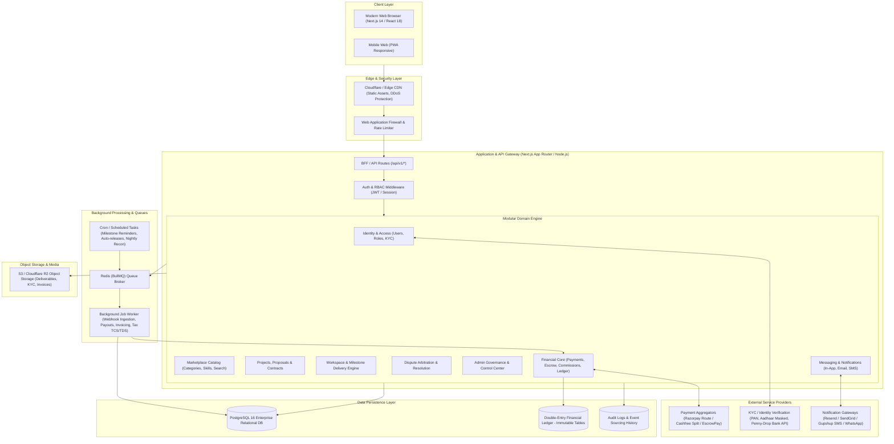
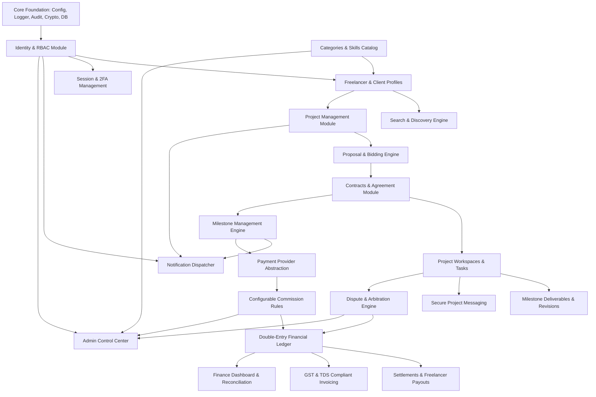
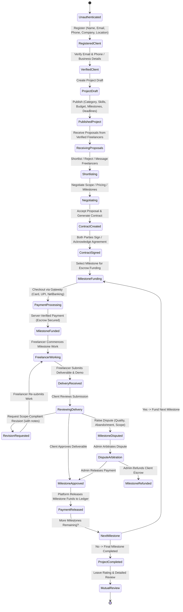
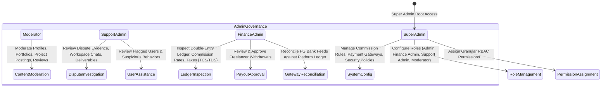
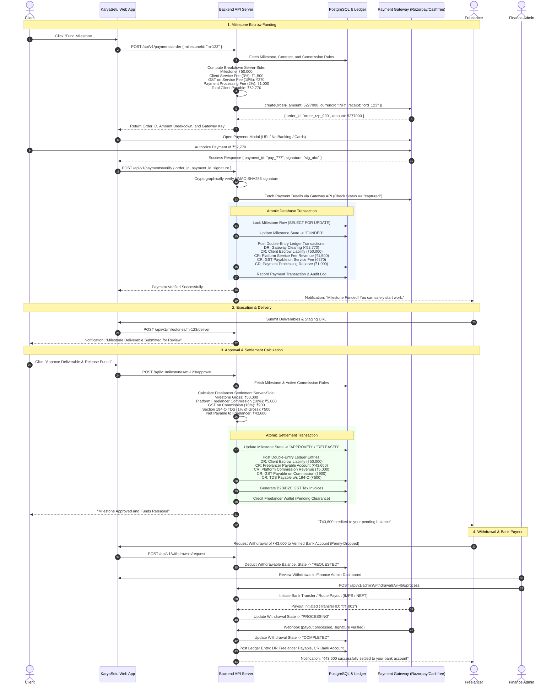

# Architecture Specification: KaryaSetu (Freelancing For India)

## 1. Executive Summary & Vision

**KaryaSetu ("The Bridge of Work")** is a production-grade, two-sided Indian freelance marketplace platform connecting Indian talent (freelancers, agencies, solo professionals) with domestic and global clients (startups, MSMEs, enterprises, individuals).

Unlike conventional e-commerce or simple classified boards, KaryaSetu is a high-trust, regulated commercial exchange governed by:
- **Bilateral Commercial Contracts** with immutable versioning.
- **Milestone-Based Escrow Financial Flows** ensuring client risk mitigation and freelancer payment guarantees.
- **Compliance with Indian Regulatory Frameworks**: Reserve Bank of India (RBI) Payment Aggregator / Nodal Escrow guidelines, Central Goods and Services Tax (CGST) Section 52 (TCS), Income Tax Act Section 194-O (TDS for e-commerce operators), and the Digital Personal Data Protection Act (DPDPA 2023).
- **Double-Entry Financial Ledger** with complete auditability, immutability, and zero client-side financial trust.
- **Multi-Role Administrative Governance** with granular Role-Based Access Control (RBAC).

---

## 2. High-Level System Architecture Diagram

---

## 3. Module Dependency Map

The application follows a **Modular Monolith** architecture with strict dependency boundaries. Modules communicate via well-defined domain service interfaces and domain events, ensuring clean modularity without distributed microservice operational overhead.

---

## 4. End-to-End System Workflows

### 4.1 Client Workflow State Machine

---

### 4.2 Freelancer Workflow State Machine

```mermaid
stateDiagram-v2
    [*] --> FreelancerRegistered: Register (Name, Email, Phone, Title, Skills, City)
    FreelancerRegistered --> KYC_Pending: Submit Profile Details & Identification
    
    KYC_Pending --> KYC_UnderReview: Upload Govt ID (PAN, Aadhaar Masked), Portfolio, Bank Details
    KYC_UnderReview --> KYC_Approved: Admin / Automated Verification Succeeds
    KYC_UnderReview --> KYC_Rejected: Verification Fails (Resubmission Allowed)
    KYC_Rejected --> KYC_Pending: Correct Documents
    
    KYC_Approved --> ActiveFreelancer: Profile Published with Verification Badges
    ActiveFreelancer --> SearchingProjects: Browse & Filter Marketplace Projects
    
    SearchingProjects --> ProposalSubmitted: Submit Structured Proposal (Price, Timeline, Milestone Plan, Cover Letter)
    ProposalSubmitted --> ProposalShortlisted: Client Shortlists Proposal
    ProposalShortlisted --> ProposalNegotiation: Direct Messaging & Milestone Refinement
    
    ProposalNegotiation --> ContractOffered: Client Accepts Proposal & Issues Contract
    ContractOffered --> ContractAccepted: Freelancer Signs Immutable Agreement
    
    ContractAccepted --> AwaitingFunding: Wait for Client to Fund Milestone Escrow
    AwaitingFunding --> WorkInProgress: Notification: Milestone Funded (Safe to Work)
    
    WorkInProgress --> DeliverableSubmitted: Upload Work, Documentation, Demo URL
    DeliverableSubmitted --> AwaitingClientReview: Client Evaluates Delivery
    
    AwaitingClientReview --> RevisionsNeeded: Client Requests Revision
    RevisionsNeeded --> WorkInProgress: Freelancer Addresses Feedback
    
    AwaitingClientReview --> MilestoneApproved: Client Approves Milestone
    MilestoneApproved --> EarningsCredited: Funds Credited to Freelancer Ledger (Net of Commission & TDS)
    
    EarningsCredited --> CoolingPeriod: Security Holding Period (e.g., T+2 Days)
    CoolingPeriod --> WithdrawableBalance: Funds Move to Withdrawable Balance
    
    WithdrawableBalance --> WithdrawalRequested: Request Payout to Verified Bank Account / UPI
    WithdrawalRequested --> SettlementProcessing: System / Finance Admin Triggers Payout
    SettlementProcessing --> SettlementCompleted: Bank Transfer Confirmed via Webhook
    
    SettlementCompleted --> ClientReviewGiven: Freelancer Leaves Rating for Client
    ClientReviewGiven --> [*]
```

---

### 4.3 Administrator Workflow & Multi-Role Governance

---

## 5. Payment, Commission & Settlement Workflow

---

## 6. Role-Based Access Control (RBAC) Matrix

| Permission Key | Super Admin | Admin | Finance Admin | Support Admin | Moderator | Client | Freelancer |
| :--- | :---: | :---: | :---: | :---: | :---: | :---: | :---: |
| `users.view` | ✅ | ✅ | ✅ | ✅ | ✅ | ❌ | ❌ |
| `users.create` | ✅ | ✅ | ❌ | ❌ | ❌ | ❌ | ❌ |
| `users.edit` | ✅ | ✅ | ❌ | ❌ | ❌ | Self | Self |
| `users.suspend` | ✅ | ✅ | ❌ | ❌ | ❌ | ❌ | ❌ |
| `users.delete` | ✅ | ❌ | ❌ | ❌ | ❌ | ❌ | ❌ |
| `freelancers.verify` | ✅ | ✅ | ❌ | ❌ | ✅ | ❌ | ❌ |
| `freelancers.kyc` | ✅ | ✅ | ✅ | ❌ | ✅ | ❌ | Self |
| `projects.view` | ✅ | ✅ | ✅ | ✅ | ✅ | Own/Pub | Own/Pub |
| `projects.manage` | ✅ | ✅ | ❌ | ❌ | ❌ | Own | ❌ |
| `proposals.view` | ✅ | ✅ | ❌ | ✅ | ❌ | Own Proj | Own Bids |
| `proposals.manage` | ✅ | ✅ | ❌ | ❌ | ❌ | Own Proj | Own Bids |
| `contracts.view` | ✅ | ✅ | ✅ | ✅ | ❌ | Own | Own |
| `contracts.manage` | ✅ | ✅ | ❌ | ❌ | ❌ | Own | Own |
| `workspaces.manage` | ✅ | ✅ | ❌ | ✅ | ❌ | Own | Own |
| `payments.view` | ✅ | ✅ | ✅ | ❌ | ❌ | Own | Own |
| `payments.manage` | ✅ | ❌ | ✅ | ❌ | ❌ | Own Pay | ❌ |
| `commissions.manage` | ✅ | ❌ | ✅ | ❌ | ❌ | ❌ | ❌ |
| `settlements.manage` | ✅ | ❌ | ✅ | ❌ | ❌ | ❌ | ❌ |
| `withdrawals.manage` | ✅ | ❌ | ✅ | ❌ | ❌ | ❌ | Own Req |
| `refunds.manage` | ✅ | ❌ | ✅ | ❌ | ❌ | Own Req | ❌ |
| `disputes.manage` | ✅ | ✅ | ❌ | ✅ | ❌ | Own Disp | Own Disp |
| `finance.reports` | ✅ | ❌ | ✅ | ❌ | ❌ | ❌ | ❌ |
| `content.manage` | ✅ | ✅ | ❌ | ❌ | ✅ | ❌ | ❌ |
| `categories.manage` | ✅ | ✅ | ❌ | ❌ | ❌ | ❌ | ❌ |
| `notifications.manage`| ✅ | ✅ | ❌ | ❌ | ❌ | ❌ | ❌ |
| `settings.manage` | ✅ | ❌ | ❌ | ❌ | ❌ | ❌ | ❌ |
| `admins.manage` | ✅ | ❌ | ❌ | ❌ | ❌ | ❌ | ❌ |
| `audit.view` | ✅ | ✅ | ✅ | ✅ | ❌ | ❌ | ❌ |

---

## 7. Technology Stack & Architecture Justification

| Layer | Selected Technology | Rationale & Enterprise Justification |
| :--- | :--- | :--- |
| **Framework** | Next.js 14+ (App Router, Server Actions, API Routes) | Unified full-stack TypeScript architecture; React Server Components for zero-bundle rendering of public directory & CMS; typed server actions for state transitions. |
| **Language** | TypeScript 5+ (Strict Mode) | End-to-end type safety across database queries, financial calculations, API requests, and UI forms. |
| **Styling & Design System** | Tailwind CSS + Radix UI + Lucide React | Custom Indian marketplace visual identity (Deep Navy `#0F172A`, Amber Saffron `#D97706`, Emerald Trust `#059669`); accessible primitives; no generic SaaS templates. |
| **Database & ORM** | PostgreSQL 16 + Prisma ORM | ACID transactions for financial ledgers; native JSONB for audit payloads and flexible metadata; robust indexing (B-Tree, GIN, Trigram). |
| **Financial Ledger** | Custom Double-Entry Ledger Engine | Enforces fundamental accounting equation (`Assets = Liabilities + Equity`); append-only transactions with debit/credit balance checks. |
| **Job Queue & Cache** | Redis 7 + BullMQ (with in-memory fallback) | Reliable asynchronous processing of payment webhooks, invoice generation, email/SMS dispatch, and reconciliation crons. |
| **Real-time Engine** | WebSockets / Server-Sent Events (SSE) | Real-time workspace collaboration, messaging, unread badges, and live milestone payment state updates. |
| **Object Storage** | S3-Compatible Storage Abstraction | Local filesystem driver for development; AWS S3 / Cloudflare R2 for production with pre-signed upload/download URLs. |
| **Testing** | Vitest + Supertest + Playwright | Unit tests for commission and ledger math; integration tests for auth and payments; end-to-end tests for client-freelancer journeys. |

---

## 8. Scalability & Operational Architecture

1. **Database Connection Pooling**: PgBouncer / Prisma connection pooling to prevent pool exhaustion during peak bidding cycles.
2. **Read-Replicas & Indexing Strategy**:
   - Primary database for writes (contracts, proposals, milestone transactions, ledger).
   - Read-replica offloading for high-frequency marketplace searches (freelancer directory, project listings, category browsing).
   - Compound B-tree indexes on `(status, created_at)` and GIN indexes on `skills` and full-text search columns.
3. **Idempotency Everywhere**:
   - Every financial endpoint (`/checkout`, `/approve`, `/refund`, `/withdraw`) requires a client-generated or server-assigned `idempotency_key` stored with an atomic Redis/DB lock.
   - Webhook processing checks `provider_event_id` to guarantee zero duplicate financial entries.
4. **Zero-Trust Financial Boundary**:
   - The frontend never passes amounts to be deducted, commissions, or tax rates.
   - Frontend only submits resource identifiers (`milestoneId`, `contractId`, `proposalId`). The backend re-fetches authoritative amounts and recalculates fees server-side.
