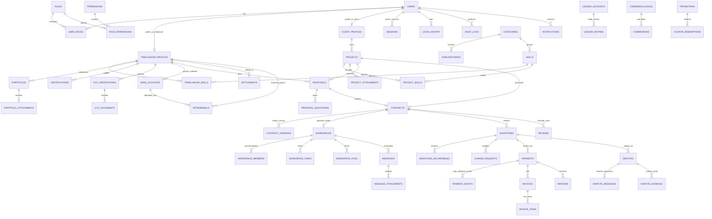

# Database Schema Specification: KaryaSetu (Freelancing For India)

## 1. Relational Entity Relationship Diagram (ERD)



---

## 2. Core Entity Catalog & Data Dictionary

### 2.1 Identity & Access Control (RBAC)

#### Table: `users`
Primary identity record for all marketplace participants.
```sql
CREATE TABLE users (
    id UUID PRIMARY KEY DEFAULT gen_random_uuid(),
    email VARCHAR(255) NOT NULL UNIQUE,
    phone VARCHAR(20) UNIQUE,
    password_hash VARCHAR(255) NOT NULL,
    full_name VARCHAR(255) NOT NULL,
    is_email_verified BOOLEAN NOT NULL DEFAULT FALSE,
    is_phone_verified BOOLEAN NOT NULL DEFAULT FALSE,
    email_verified_at TIMESTAMPTZ,
    phone_verified_at TIMESTAMPTZ,
    two_factor_secret VARCHAR(255),
    is_two_factor_enabled BOOLEAN NOT NULL DEFAULT FALSE,
    status VARCHAR(50) NOT NULL DEFAULT 'ACTIVE' 
        CHECK (status IN ('ACTIVE', 'PENDING_VERIFICATION', 'SUSPENDED', 'DEACTIVATED', 'FLAGGED')),
    suspension_reason TEXT,
    suspended_until TIMESTAMPTZ,
    failed_login_attempts INT NOT NULL DEFAULT 0,
    lockout_until TIMESTAMPTZ,
    last_login_at TIMESTAMPTZ,
    last_login_ip VARCHAR(45),
    created_at TIMESTAMPTZ NOT NULL DEFAULT CURRENT_TIMESTAMP,
    updated_at TIMESTAMPTZ NOT NULL DEFAULT CURRENT_TIMESTAMP,
    deleted_at TIMESTAMPTZ
);
CREATE INDEX idx_users_email ON users(email);
CREATE INDEX idx_users_phone ON users(phone);
CREATE INDEX idx_users_status ON users(status);
```

#### Table: `roles` & `permissions`
Granular Role-Based Access Control configuration.
```sql
CREATE TABLE roles (
    id UUID PRIMARY KEY DEFAULT gen_random_uuid(),
    name VARCHAR(50) NOT NULL UNIQUE,
    display_name VARCHAR(100) NOT NULL,
    description TEXT,
    is_system_role BOOLEAN NOT NULL DEFAULT FALSE,
    created_at TIMESTAMPTZ NOT NULL DEFAULT CURRENT_TIMESTAMP,
    updated_at TIMESTAMPTZ NOT NULL DEFAULT CURRENT_TIMESTAMP
);

CREATE TABLE permissions (
    id UUID PRIMARY KEY DEFAULT gen_random_uuid(),
    key VARCHAR(100) NOT NULL UNIQUE,
    name VARCHAR(100) NOT NULL,
    module VARCHAR(50) NOT NULL,
    description TEXT,
    created_at TIMESTAMPTZ NOT NULL DEFAULT CURRENT_TIMESTAMP
);

CREATE TABLE role_permissions (
    role_id UUID NOT NULL REFERENCES roles(id) ON DELETE CASCADE,
    permission_id UUID NOT NULL REFERENCES permissions(id) ON DELETE CASCADE,
    PRIMARY KEY (role_id, permission_id)
);

CREATE TABLE user_roles (
    user_id UUID NOT NULL REFERENCES users(id) ON DELETE CASCADE,
    role_id UUID NOT NULL REFERENCES roles(id) ON DELETE CASCADE,
    assigned_by UUID REFERENCES users(id),
    assigned_at TIMESTAMPTZ NOT NULL DEFAULT CURRENT_TIMESTAMP,
    PRIMARY KEY (user_id, role_id)
);
```

#### Table: `sessions` & `login_history`
```sql
CREATE TABLE sessions (
    id UUID PRIMARY KEY DEFAULT gen_random_uuid(),
    user_id UUID NOT NULL REFERENCES users(id) ON DELETE CASCADE,
    token_hash VARCHAR(255) NOT NULL UNIQUE,
    ip_address VARCHAR(45) NOT NULL,
    user_agent TEXT,
    device_info JSONB,
    expires_at TIMESTAMPTZ NOT NULL,
    created_at TIMESTAMPTZ NOT NULL DEFAULT CURRENT_TIMESTAMP
);
CREATE INDEX idx_sessions_user_expires ON sessions(user_id, expires_at);

CREATE TABLE login_history (
    id UUID PRIMARY KEY DEFAULT gen_random_uuid(),
    user_id UUID REFERENCES users(id) ON DELETE SET NULL,
    email_attempted VARCHAR(255) NOT NULL,
    ip_address VARCHAR(45) NOT NULL,
    user_agent TEXT,
    status VARCHAR(50) NOT NULL CHECK (status IN ('SUCCESS', 'INVALID_CREDENTIALS', 'LOCKED_OUT', '2FA_FAILED')),
    failure_reason TEXT,
    created_at TIMESTAMPTZ NOT NULL DEFAULT CURRENT_TIMESTAMP
);
CREATE INDEX idx_login_history_user ON login_history(user_id, created_at DESC);
```

---

### 2.2 Profiles, Skills & KYC

#### Table: `freelancer_profiles`
Comprehensive profile representing verified Indian professionals.
```sql
CREATE TABLE freelancer_profiles (
    id UUID PRIMARY KEY DEFAULT gen_random_uuid(),
    user_id UUID NOT NULL UNIQUE REFERENCES users(id) ON DELETE CASCADE,
    professional_title VARCHAR(255) NOT NULL,
    bio TEXT NOT NULL,
    profile_photo_url TEXT,
    banner_url TEXT,
    hourly_rate_inr NUMERIC(12, 2),
    min_project_budget_inr NUMERIC(12, 2) DEFAULT 1000.00,
    experience_years NUMERIC(4, 1) NOT NULL DEFAULT 0.0,
    availability_status VARCHAR(50) NOT NULL DEFAULT 'AVAILABLE'
        CHECK (availability_status IN ('AVAILABLE', 'BUSY', 'NOT_ACCEPTING_WORK')),
    city VARCHAR(100) NOT NULL,
    state VARCHAR(100) NOT NULL,
    pincode VARCHAR(10) NOT NULL,
    languages JSONB NOT NULL DEFAULT '["English", "Hindi"]',
    kyc_status VARCHAR(50) NOT NULL DEFAULT 'PENDING'
        CHECK (kyc_status IN ('PENDING', 'SUBMITTED', 'UNDER_REVIEW', 'APPROVED', 'REJECTED', 'RESUBMISSION_REQUIRED', 'SUSPENDED')),
    is_verified_badge BOOLEAN NOT NULL DEFAULT FALSE,
    is_top_rated BOOLEAN NOT NULL DEFAULT FALSE,
    total_earnings_inr NUMERIC(14, 2) NOT NULL DEFAULT 0.00,
    withdrawable_balance_inr NUMERIC(14, 2) NOT NULL DEFAULT 0.00,
    pending_clearance_inr NUMERIC(14, 2) NOT NULL DEFAULT 0.00,
    completed_projects_count INT NOT NULL DEFAULT 0,
    rating_average NUMERIC(3, 2) NOT NULL DEFAULT 0.00,
    rating_count INT NOT NULL DEFAULT 0,
    response_rate_percentage NUMERIC(5, 2) NOT NULL DEFAULT 100.00,
    on_time_delivery_rate NUMERIC(5, 2) NOT NULL DEFAULT 100.00,
    profile_completeness_percentage INT NOT NULL DEFAULT 20,
    admin_notes TEXT,
    created_at TIMESTAMPTZ NOT NULL DEFAULT CURRENT_TIMESTAMP,
    updated_at TIMESTAMPTZ NOT NULL DEFAULT CURRENT_TIMESTAMP
);
CREATE INDEX idx_freelancer_kyc_status ON freelancer_profiles(kyc_status);
CREATE INDEX idx_freelancer_rating ON freelancer_profiles(rating_average DESC);
CREATE INDEX idx_freelancer_location ON freelancer_profiles(state, city);
```

#### Table: `client_profiles`
Profile of hiring organizations and individuals.
```sql
CREATE TABLE client_profiles (
    id UUID PRIMARY KEY DEFAULT gen_random_uuid(),
    user_id UUID NOT NULL UNIQUE REFERENCES users(id) ON DELETE CASCADE,
    client_type VARCHAR(50) NOT NULL DEFAULT 'INDIVIDUAL' 
        CHECK (client_type IN ('INDIVIDUAL', 'PROPRIETORSHIP', 'LLP', 'PRIVATE_LIMITED', 'ENTERPRISE')),
    company_name VARCHAR(255),
    company_logo_url TEXT,
    company_website VARCHAR(255),
    company_description TEXT,
    gstin VARCHAR(15), -- Indian GST Identification Number
    pan_number VARCHAR(10), -- Permanent Account Number
    billing_address_line1 TEXT,
    billing_address_line2 TEXT,
    city VARCHAR(100) NOT NULL,
    state VARCHAR(100) NOT NULL,
    pincode VARCHAR(10) NOT NULL,
    is_gst_verified BOOLEAN NOT NULL DEFAULT FALSE,
    is_verified_badge BOOLEAN NOT NULL DEFAULT FALSE,
    total_spent_inr NUMERIC(14, 2) NOT NULL DEFAULT 0.00,
    projects_posted_count INT NOT NULL DEFAULT 0,
    projects_hired_count INT NOT NULL DEFAULT 0,
    rating_average NUMERIC(3, 2) NOT NULL DEFAULT 0.00,
    rating_count INT NOT NULL DEFAULT 0,
    created_at TIMESTAMPTZ NOT NULL DEFAULT CURRENT_TIMESTAMP,
    updated_at TIMESTAMPTZ NOT NULL DEFAULT CURRENT_TIMESTAMP
);
CREATE INDEX idx_client_gstin ON client_profiles(gstin);
```

#### Table: `kyc_verifications` & `kyc_documents`
```sql
CREATE TABLE kyc_verifications (
    id UUID PRIMARY KEY DEFAULT gen_random_uuid(),
    freelancer_id UUID NOT NULL REFERENCES freelancer_profiles(id) ON DELETE CASCADE,
    pan_number VARCHAR(10) NOT NULL,
    pan_name VARCHAR(255) NOT NULL,
    pan_verified BOOLEAN NOT NULL DEFAULT FALSE,
    aadhaar_masked VARCHAR(20), -- e.g. "XXXXXXXX1234"
    aadhaar_verified BOOLEAN NOT NULL DEFAULT FALSE,
    bank_account_verified BOOLEAN NOT NULL DEFAULT FALSE,
    status VARCHAR(50) NOT NULL DEFAULT 'SUBMITTED'
        CHECK (status IN ('SUBMITTED', 'UNDER_REVIEW', 'APPROVED', 'REJECTED', 'RESUBMISSION_REQUIRED')),
    rejection_reason TEXT,
    reviewer_user_id UUID REFERENCES users(id),
    reviewed_at TIMESTAMPTZ,
    created_at TIMESTAMPTZ NOT NULL DEFAULT CURRENT_TIMESTAMP,
    updated_at TIMESTAMPTZ NOT NULL DEFAULT CURRENT_TIMESTAMP
);

CREATE TABLE kyc_documents (
    id UUID PRIMARY KEY DEFAULT gen_random_uuid(),
    kyc_id UUID NOT NULL REFERENCES kyc_verifications(id) ON DELETE CASCADE,
    document_type VARCHAR(50) NOT NULL CHECK (document_type IN ('PAN_CARD', 'AADHAAR_FRONT', 'AADHAAR_BACK', 'CANCELLED_CHEQUE', 'BANK_STATEMENT')),
    file_url TEXT NOT NULL,
    file_mime_type VARCHAR(100) NOT NULL,
    file_size_bytes BIGINT NOT NULL,
    uploaded_at TIMESTAMPTZ NOT NULL DEFAULT CURRENT_TIMESTAMP
);
```

#### Table: `bank_accounts`
Bank account and UPI details verified via penny-drop.
```sql
CREATE TABLE bank_accounts (
    id UUID PRIMARY KEY DEFAULT gen_random_uuid(),
    freelancer_id UUID NOT NULL REFERENCES freelancer_profiles(id) ON DELETE CASCADE,
    account_holder_name VARCHAR(255) NOT NULL,
    account_number_encrypted TEXT NOT NULL,
    account_number_masked VARCHAR(20) NOT NULL, -- "XXXXXX5678"
    ifsc_code VARCHAR(11) NOT NULL,
    bank_name VARCHAR(255) NOT NULL,
    branch_name VARCHAR(255),
    upi_vpa VARCHAR(255),
    is_primary BOOLEAN NOT NULL DEFAULT TRUE,
    verification_status VARCHAR(50) NOT NULL DEFAULT 'PENDING'
        CHECK (verification_status IN ('PENDING', 'PENNY_DROP_INITIATED', 'VERIFIED', 'FAILED')),
    penny_drop_reference VARCHAR(100),
    penny_drop_name_match_score NUMERIC(5, 2),
    created_at TIMESTAMPTZ NOT NULL DEFAULT CURRENT_TIMESTAMP,
    updated_at TIMESTAMPTZ NOT NULL DEFAULT CURRENT_TIMESTAMP
);
CREATE INDEX idx_bank_accounts_freelancer ON bank_accounts(freelancer_id);
```

#### Table: `categories`, `subcategories` & `skills`
```sql
CREATE TABLE categories (
    id UUID PRIMARY KEY DEFAULT gen_random_uuid(),
    name VARCHAR(100) NOT NULL UNIQUE,
    slug VARCHAR(120) NOT NULL UNIQUE,
    description TEXT,
    icon_name VARCHAR(50),
    image_url TEXT,
    sort_order INT NOT NULL DEFAULT 0,
    is_active BOOLEAN NOT NULL DEFAULT TRUE,
    created_at TIMESTAMPTZ NOT NULL DEFAULT CURRENT_TIMESTAMP
);

CREATE TABLE subcategories (
    id UUID PRIMARY KEY DEFAULT gen_random_uuid(),
    category_id UUID NOT NULL REFERENCES categories(id) ON DELETE CASCADE,
    name VARCHAR(100) NOT NULL,
    slug VARCHAR(120) NOT NULL UNIQUE,
    description TEXT,
    sort_order INT NOT NULL DEFAULT 0,
    is_active BOOLEAN NOT NULL DEFAULT TRUE,
    created_at TIMESTAMPTZ NOT NULL DEFAULT CURRENT_TIMESTAMP
);

CREATE TABLE skills (
    id UUID PRIMARY KEY DEFAULT gen_random_uuid(),
    category_id UUID REFERENCES categories(id) ON DELETE SET NULL,
    name VARCHAR(100) NOT NULL UNIQUE,
    slug VARCHAR(120) NOT NULL UNIQUE,
    is_active BOOLEAN NOT NULL DEFAULT TRUE,
    created_at TIMESTAMPTZ NOT NULL DEFAULT CURRENT_TIMESTAMP
);

CREATE TABLE freelancer_skills (
    freelancer_id UUID NOT NULL REFERENCES freelancer_profiles(id) ON DELETE CASCADE,
    skill_id UUID NOT NULL REFERENCES skills(id) ON DELETE CASCADE,
    proficiency_level VARCHAR(50) DEFAULT 'INTERMEDIATE' 
        CHECK (proficiency_level IN ('BEGINNER', 'INTERMEDIATE', 'EXPERT')),
    PRIMARY KEY (freelancer_id, skill_id)
);
```

---

### 2.3 Commercial Engagements: Projects, Proposals & Contracts

#### Table: `projects`
```sql
CREATE TABLE projects (
    id UUID PRIMARY KEY DEFAULT gen_random_uuid(),
    client_id UUID NOT NULL REFERENCES client_profiles(id) ON DELETE CASCADE,
    category_id UUID NOT NULL REFERENCES categories(id),
    subcategory_id UUID REFERENCES subcategories(id),
    title VARCHAR(255) NOT NULL,
    slug VARCHAR(280) NOT NULL UNIQUE,
    description TEXT NOT NULL,
    budget_type VARCHAR(20) NOT NULL CHECK (budget_type IN ('FIXED', 'HOURLY')),
    min_budget_inr NUMERIC(12, 2) NOT NULL,
    max_budget_inr NUMERIC(12, 2) NOT NULL,
    estimated_duration VARCHAR(50) NOT NULL,
    deadline_date DATE,
    experience_level VARCHAR(50) NOT NULL DEFAULT 'INTERMEDIATE'
        CHECK (experience_level IN ('ENTRY', 'INTERMEDIATE', 'EXPERT')),
    visibility VARCHAR(50) NOT NULL DEFAULT 'PUBLIC'
        CHECK (visibility IN ('PUBLIC', 'PRIVATE', 'INVITE_ONLY')),
    status VARCHAR(50) NOT NULL DEFAULT 'PUBLISHED'
        CHECK (status IN ('DRAFT', 'PUBLISHED', 'UNDER_REVIEW', 'PAUSED', 'CANCELLED', 'IN_PROGRESS', 'COMPLETED', 'DISPUTED', 'CLOSED')),
    hired_freelancer_id UUID REFERENCES freelancer_profiles(id),
    proposals_count INT NOT NULL DEFAULT 0,
    views_count INT NOT NULL DEFAULT 0,
    created_at TIMESTAMPTZ NOT NULL DEFAULT CURRENT_TIMESTAMP,
    updated_at TIMESTAMPTZ NOT NULL DEFAULT CURRENT_TIMESTAMP,
    published_at TIMESTAMPTZ
);
CREATE INDEX idx_projects_status_created ON projects(status, created_at DESC);
CREATE INDEX idx_projects_category ON projects(category_id);
```

#### Table: `proposals` & `proposal_milestones`
```sql
CREATE TABLE proposals (
    id UUID PRIMARY KEY DEFAULT gen_random_uuid(),
    project_id UUID NOT NULL REFERENCES projects(id) ON DELETE CASCADE,
    freelancer_id UUID NOT NULL REFERENCES freelancer_profiles(id) ON DELETE CASCADE,
    bid_amount_inr NUMERIC(12, 2) NOT NULL,
    estimated_duration_days INT NOT NULL,
    cover_letter TEXT NOT NULL,
    status VARCHAR(50) NOT NULL DEFAULT 'SUBMITTED'
        CHECK (status IN ('DRAFT', 'SUBMITTED', 'SHORTLISTED', 'NEGOTIATING', 'ACCEPTED', 'REJECTED', 'WITHDRAWN', 'EXPIRED')),
    client_rejection_reason TEXT,
    created_at TIMESTAMPTZ NOT NULL DEFAULT CURRENT_TIMESTAMP,
    updated_at TIMESTAMPTZ NOT NULL DEFAULT CURRENT_TIMESTAMP,
    UNIQUE(project_id, freelancer_id)
);
CREATE INDEX idx_proposals_project_status ON proposals(project_id, status);

CREATE TABLE proposal_milestones (
    id UUID PRIMARY KEY DEFAULT gen_random_uuid(),
    proposal_id UUID NOT NULL REFERENCES proposals(id) ON DELETE CASCADE,
    title VARCHAR(255) NOT NULL,
    description TEXT,
    amount_inr NUMERIC(12, 2) NOT NULL,
    duration_days INT NOT NULL,
    sort_order INT NOT NULL DEFAULT 1
);
```

#### Table: `contracts` & `contract_versions`
Bilateral legal agreement binding the project scope, payment schedules, and terms.
```sql
CREATE TABLE contracts (
    id UUID PRIMARY KEY DEFAULT gen_random_uuid(),
    contract_number VARCHAR(50) NOT NULL UNIQUE, -- e.g. "KS-CTR-2026-00104"
    project_id UUID NOT NULL REFERENCES projects(id),
    proposal_id UUID NOT NULL REFERENCES proposals(id),
    client_id UUID NOT NULL REFERENCES client_profiles(id),
    freelancer_id UUID NOT NULL REFERENCES freelancer_profiles(id),
    total_contract_value_inr NUMERIC(12, 2) NOT NULL,
    client_service_fee_rate NUMERIC(5, 4) NOT NULL, -- e.g. 0.0300 (3%)
    freelancer_commission_rate NUMERIC(5, 4) NOT NULL, -- e.g. 0.1000 (10%)
    terms_and_conditions TEXT NOT NULL,
    client_signed_at TIMESTAMPTZ,
    client_signature_hash VARCHAR(255),
    freelancer_signed_at TIMESTAMPTZ,
    freelancer_signature_hash VARCHAR(255),
    status VARCHAR(50) NOT NULL DEFAULT 'ACTIVE'
        CHECK (status IN ('PENDING_SIGNATURES', 'ACTIVE', 'COMPLETED', 'DISPUTED', 'TERMINATED', 'CANCELLED')),
    version_number INT NOT NULL DEFAULT 1,
    created_at TIMESTAMPTZ NOT NULL DEFAULT CURRENT_TIMESTAMP,
    updated_at TIMESTAMPTZ NOT NULL DEFAULT CURRENT_TIMESTAMP
);
CREATE INDEX idx_contracts_client ON contracts(client_id);
CREATE INDEX idx_contracts_freelancer ON contracts(freelancer_id);

CREATE TABLE contract_versions (
    id UUID PRIMARY KEY DEFAULT gen_random_uuid(),
    contract_id UUID NOT NULL REFERENCES contracts(id) ON DELETE CASCADE,
    version INT NOT NULL,
    contract_payload JSONB NOT NULL,
    changed_by UUID NOT NULL REFERENCES users(id),
    change_reason TEXT NOT NULL,
    created_at TIMESTAMPTZ NOT NULL DEFAULT CURRENT_TIMESTAMP
);
```

#### Table: `milestones` & `milestone_deliverables`
```sql
CREATE TABLE milestones (
    id UUID PRIMARY KEY DEFAULT gen_random_uuid(),
    contract_id UUID NOT NULL REFERENCES contracts(id) ON DELETE CASCADE,
    title VARCHAR(255) NOT NULL,
    description TEXT,
    amount_inr NUMERIC(12, 2) NOT NULL,
    due_date DATE,
    sort_order INT NOT NULL DEFAULT 1,
    status VARCHAR(50) NOT NULL DEFAULT 'DRAFT'
        CHECK (status IN (
            'DRAFT', 'AGREED', 'AWAITING_FUNDING', 'FUNDED', 
            'IN_PROGRESS', 'SUBMITTED', 'REVISION_REQUESTED', 
            'APPROVED', 'RELEASED', 'REFUNDED', 'DISPUTED', 'CANCELLED'
        )),
    funded_at TIMESTAMPTZ,
    submitted_at TIMESTAMPTZ,
    approved_at TIMESTAMPTZ,
    released_at TIMESTAMPTZ,
    created_at TIMESTAMPTZ NOT NULL DEFAULT CURRENT_TIMESTAMP,
    updated_at TIMESTAMPTZ NOT NULL DEFAULT CURRENT_TIMESTAMP
);
CREATE INDEX idx_milestones_contract_status ON milestones(contract_id, status);

CREATE TABLE milestone_deliverables (
    id UUID PRIMARY KEY DEFAULT gen_random_uuid(),
    milestone_id UUID NOT NULL REFERENCES milestones(id) ON DELETE CASCADE,
    freelancer_notes TEXT NOT NULL,
    demo_url TEXT,
    file_urls JSONB NOT NULL DEFAULT '[]',
    submitted_at TIMESTAMPTZ NOT NULL DEFAULT CURRENT_TIMESTAMP,
    client_feedback TEXT,
    client_reviewed_at TIMESTAMPTZ,
    status VARCHAR(50) NOT NULL DEFAULT 'SUBMITTED'
        CHECK (status IN ('SUBMITTED', 'REVISION_REQUESTED', 'APPROVED', 'DISPUTED'))
);
```

#### Table: `change_requests`
```sql
CREATE TABLE change_requests (
    id UUID PRIMARY KEY DEFAULT gen_random_uuid(),
    milestone_id UUID REFERENCES milestones(id) ON DELETE SET NULL,
    contract_id UUID NOT NULL REFERENCES contracts(id) ON DELETE CASCADE,
    requested_by UUID NOT NULL REFERENCES users(id),
    title VARCHAR(255) NOT NULL,
    description TEXT NOT NULL,
    additional_price_inr NUMERIC(12, 2) NOT NULL DEFAULT 0.00,
    additional_days INT NOT NULL DEFAULT 0,
    status VARCHAR(50) NOT NULL DEFAULT 'REQUESTED'
        CHECK (status IN ('REQUESTED', 'NEGOTIATING', 'ACCEPTED', 'REJECTED', 'CANCELLED', 'COMPLETED')),
    created_at TIMESTAMPTZ NOT NULL DEFAULT CURRENT_TIMESTAMP,
    updated_at TIMESTAMPTZ NOT NULL DEFAULT CURRENT_TIMESTAMP
);
```

---

### 2.4 Collaboration, Workspaces & Messaging

#### Table: `workspaces`, `workspace_tasks`, `workspace_files`
```sql
CREATE TABLE workspaces (
    id UUID PRIMARY KEY DEFAULT gen_random_uuid(),
    contract_id UUID NOT NULL UNIQUE REFERENCES contracts(id) ON DELETE CASCADE,
    title VARCHAR(255) NOT NULL,
    status VARCHAR(50) NOT NULL DEFAULT 'ACTIVE' CHECK (status IN ('ACTIVE', 'ARCHIVED', 'SUSPENDED')),
    created_at TIMESTAMPTZ NOT NULL DEFAULT CURRENT_TIMESTAMP,
    updated_at TIMESTAMPTZ NOT NULL DEFAULT CURRENT_TIMESTAMP
);

CREATE TABLE workspace_members (
    workspace_id UUID NOT NULL REFERENCES workspaces(id) ON DELETE CASCADE,
    user_id UUID NOT NULL REFERENCES users(id) ON DELETE CASCADE,
    role VARCHAR(50) NOT NULL CHECK (role IN ('CLIENT', 'FREELANCER', 'ADMIN_OBSERVER')),
    joined_at TIMESTAMPTZ NOT NULL DEFAULT CURRENT_TIMESTAMP,
    PRIMARY KEY (workspace_id, user_id)
);

CREATE TABLE messages (
    id UUID PRIMARY KEY DEFAULT gen_random_uuid(),
    workspace_id UUID NOT NULL REFERENCES workspaces(id) ON DELETE CASCADE,
    sender_user_id UUID NOT NULL REFERENCES users(id),
    content TEXT,
    is_system_message BOOLEAN NOT NULL DEFAULT FALSE,
    system_event_type VARCHAR(50),
    is_read BOOLEAN NOT NULL DEFAULT FALSE,
    read_at TIMESTAMPTZ,
    created_at TIMESTAMPTZ NOT NULL DEFAULT CURRENT_TIMESTAMP
);
CREATE INDEX idx_messages_workspace_created ON messages(workspace_id, created_at DESC);

CREATE TABLE message_attachments (
    id UUID PRIMARY KEY DEFAULT gen_random_uuid(),
    message_id UUID NOT NULL REFERENCES messages(id) ON DELETE CASCADE,
    file_name VARCHAR(255) NOT NULL,
    file_url TEXT NOT NULL,
    file_size_bytes BIGINT NOT NULL,
    mime_type VARCHAR(100) NOT NULL,
    created_at TIMESTAMPTZ NOT NULL DEFAULT CURRENT_TIMESTAMP
);
```

---

### 2.5 Financial Core: Payments, Double-Entry Ledger & Settlements

#### Table: `commission_rules` & `commissions`
```sql
CREATE TABLE commission_rules (
    id UUID PRIMARY KEY DEFAULT gen_random_uuid(),
    rule_name VARCHAR(100) NOT NULL,
    category_id UUID REFERENCES categories(id) ON DELETE SET NULL,
    client_fee_percentage NUMERIC(5, 2) NOT NULL DEFAULT 3.00,
    client_fee_fixed_inr NUMERIC(10, 2) NOT NULL DEFAULT 0.00,
    freelancer_commission_percentage NUMERIC(5, 2) NOT NULL DEFAULT 10.00,
    freelancer_commission_fixed_inr NUMERIC(10, 2) NOT NULL DEFAULT 0.00,
    min_commission_inr NUMERIC(10, 2) NOT NULL DEFAULT 50.00,
    max_commission_inr NUMERIC(10, 2),
    is_active BOOLEAN NOT NULL DEFAULT TRUE,
    effective_from TIMESTAMPTZ NOT NULL DEFAULT CURRENT_TIMESTAMP,
    effective_to TIMESTAMPTZ,
    created_by UUID REFERENCES users(id),
    created_at TIMESTAMPTZ NOT NULL DEFAULT CURRENT_TIMESTAMP
);

CREATE TABLE commissions (
    id UUID PRIMARY KEY DEFAULT gen_random_uuid(),
    milestone_id UUID NOT NULL UNIQUE REFERENCES milestones(id),
    commission_rule_id UUID NOT NULL REFERENCES commission_rules(id),
    gross_milestone_amount_inr NUMERIC(12, 2) NOT NULL,
    client_service_fee_inr NUMERIC(12, 2) NOT NULL,
    freelancer_commission_inr NUMERIC(12, 2) NOT NULL,
    gst_on_client_fee_inr NUMERIC(12, 2) NOT NULL,
    gst_on_freelancer_commission_inr NUMERIC(12, 2) NOT NULL,
    tds_194o_deducted_inr NUMERIC(12, 2) NOT NULL,
    net_freelancer_receivable_inr NUMERIC(12, 2) NOT NULL,
    total_client_charged_inr NUMERIC(12, 2) NOT NULL,
    created_at TIMESTAMPTZ NOT NULL DEFAULT CURRENT_TIMESTAMP
);
```

#### Table: `payments` & `payment_events`
```sql
CREATE TABLE payments (
    id UUID PRIMARY KEY DEFAULT gen_random_uuid(),
    payment_reference VARCHAR(100) NOT NULL UNIQUE, -- Platform Internal Reference e.g. "KS-PAY-2026-991"
    milestone_id UUID NOT NULL REFERENCES milestones(id),
    client_id UUID NOT NULL REFERENCES client_profiles(id),
    provider_name VARCHAR(50) NOT NULL CHECK (provider_name IN ('MOCK', 'RAZORPAY_ROUTE', 'CASHFREE', 'ESCROWPAY')),
    gateway_order_id VARCHAR(255) NOT NULL,
    gateway_payment_id VARCHAR(255),
    gateway_signature VARCHAR(255),
    amount_inr NUMERIC(12, 2) NOT NULL,
    currency VARCHAR(3) NOT NULL DEFAULT 'INR',
    payment_method VARCHAR(50), -- 'UPI', 'CREDIT_CARD', 'DEBIT_CARD', 'NETBANKING'
    status VARCHAR(50) NOT NULL DEFAULT 'INITIATED'
        CHECK (status IN ('INITIATED', 'AUTHORIZED', 'CAPTURED', 'FAILED', 'REFUNDED', 'DISPUTED')),
    idempotency_key VARCHAR(255) NOT NULL UNIQUE,
    failure_reason TEXT,
    metadata JSONB,
    created_at TIMESTAMPTZ NOT NULL DEFAULT CURRENT_TIMESTAMP,
    updated_at TIMESTAMPTZ NOT NULL DEFAULT CURRENT_TIMESTAMP
);
CREATE INDEX idx_payments_gateway_order ON payments(gateway_order_id);
CREATE INDEX idx_payments_status ON payments(status);

CREATE TABLE payment_events (
    id UUID PRIMARY KEY DEFAULT gen_random_uuid(),
    provider_name VARCHAR(50) NOT NULL,
    provider_event_id VARCHAR(255) NOT NULL UNIQUE,
    event_type VARCHAR(100) NOT NULL,
    payload JSONB NOT NULL,
    signature VARCHAR(255),
    is_processed BOOLEAN NOT NULL DEFAULT FALSE,
    processed_at TIMESTAMPTZ,
    error_message TEXT,
    created_at TIMESTAMPTZ NOT NULL DEFAULT CURRENT_TIMESTAMP
);
CREATE INDEX idx_payment_events_provider_id ON payment_events(provider_event_id);
```

#### Tables: `ledger_accounts` & `ledger_entries` (Double-Entry Financial Bookkeeping)
The immutable heart of the marketplace financial system.
```sql
CREATE TABLE ledger_accounts (
    id UUID PRIMARY KEY DEFAULT gen_random_uuid(),
    account_code VARCHAR(50) NOT NULL UNIQUE, -- e.g. "1010-ESCROW-BANK", "2010-CLIENT-DEPOSIT-ESCROW", "4010-PLATFORM-COMMISSION"
    account_name VARCHAR(100) NOT NULL,
    account_type VARCHAR(50) NOT NULL CHECK (account_type IN ('ASSET', 'LIABILITY', 'EQUITY', 'REVENUE', 'EXPENSE')),
    is_active BOOLEAN NOT NULL DEFAULT TRUE,
    created_at TIMESTAMPTZ NOT NULL DEFAULT CURRENT_TIMESTAMP
);

CREATE TABLE ledger_entries (
    id UUID PRIMARY KEY DEFAULT gen_random_uuid(),
    transaction_group_id UUID NOT NULL, -- Identifies all balanced legs of a single atomic financial event
    account_id UUID NOT NULL REFERENCES ledger_accounts(id),
    direction VARCHAR(6) NOT NULL CHECK (direction IN ('DEBIT', 'CREDIT')),
    amount_inr NUMERIC(14, 2) NOT NULL CHECK (amount_inr > 0),
    currency VARCHAR(3) NOT NULL DEFAULT 'INR',
    project_id UUID REFERENCES projects(id),
    milestone_id UUID REFERENCES milestones(id),
    payment_id UUID REFERENCES payments(id),
    user_id UUID REFERENCES users(id),
    description VARCHAR(255) NOT NULL,
    reference_type VARCHAR(50) NOT NULL, -- 'ESCROW_FUNDING', 'MILESTONE_RELEASE', 'COMMISSION_EARNED', 'WITHDRAWAL_PAYOUT', 'REFUND'
    created_at TIMESTAMPTZ NOT NULL DEFAULT CURRENT_TIMESTAMP
);
CREATE INDEX idx_ledger_transaction_group ON ledger_entries(transaction_group_id);
CREATE INDEX idx_ledger_account_created ON ledger_entries(account_id, created_at);

-- INVARIANT: Ledger entries must NEVER be updated or deleted. Enforce via trigger.
CREATE OR REPLACE FUNCTION prevent_ledger_modification()
RETURNS TRIGGER AS $$
BEGIN
    RAISE EXCEPTION 'Ledger entries are strictly immutable. Correction must be made via reversal entries.';
END;
$$ LANGUAGE plpgsql;

CREATE TRIGGER trg_ledger_immutable
BEFORE UPDATE OR DELETE ON ledger_entries
FOR EACH ROW EXECUTE FUNCTION prevent_ledger_modification();
```

#### Table: `settlements` & `withdrawals`
```sql
CREATE TABLE settlements (
    id UUID PRIMARY KEY DEFAULT gen_random_uuid(),
    settlement_reference VARCHAR(100) NOT NULL UNIQUE,
    milestone_id UUID NOT NULL REFERENCES milestones(id),
    freelancer_id UUID NOT NULL REFERENCES freelancer_profiles(id),
    gross_amount_inr NUMERIC(12, 2) NOT NULL,
    deductions_inr NUMERIC(12, 2) NOT NULL,
    net_settled_inr NUMERIC(12, 2) NOT NULL,
    status VARCHAR(50) NOT NULL DEFAULT 'PENDING_CLEARANCE'
        CHECK (status IN ('PENDING_CLEARANCE', 'CLEARED_FOR_WITHDRAWAL', 'SETTLED', 'FAILED', 'REVERSED')),
    cleared_at TIMESTAMPTZ,
    created_at TIMESTAMPTZ NOT NULL DEFAULT CURRENT_TIMESTAMP
);

CREATE TABLE withdrawals (
    id UUID PRIMARY KEY DEFAULT gen_random_uuid(),
    withdrawal_reference VARCHAR(100) NOT NULL UNIQUE,
    freelancer_id UUID NOT NULL REFERENCES freelancer_profiles(id),
    bank_account_id UUID NOT NULL REFERENCES bank_accounts(id),
    amount_inr NUMERIC(12, 2) NOT NULL CHECK (amount_inr >= 500.00), -- Minimum withdrawal ₹500
    payout_mode VARCHAR(20) NOT NULL DEFAULT 'IMPS' CHECK (payout_mode IN ('IMPS', 'NEFT', 'RTGS', 'UPI')),
    status VARCHAR(50) NOT NULL DEFAULT 'REQUESTED'
        CHECK (status IN ('REQUESTED', 'UNDER_REVIEW', 'APPROVED', 'PROCESSING', 'COMPLETED', 'FAILED', 'REJECTED', 'CANCELLED')),
    gateway_payout_id VARCHAR(255),
    utr_number VARCHAR(100), -- Unique Transaction Reference from Bank
    admin_reviewed_by UUID REFERENCES users(id),
    rejection_reason TEXT,
    requested_at TIMESTAMPTZ NOT NULL DEFAULT CURRENT_TIMESTAMP,
    processed_at TIMESTAMPTZ,
    completed_at TIMESTAMPTZ
);
CREATE INDEX idx_withdrawals_freelancer ON withdrawals(freelancer_id, status);
```

#### Table: `refunds` & `disputes`
```sql
CREATE TABLE refunds (
    id UUID PRIMARY KEY DEFAULT gen_random_uuid(),
    refund_reference VARCHAR(100) NOT NULL UNIQUE,
    payment_id UUID NOT NULL REFERENCES payments(id),
    milestone_id UUID NOT NULL REFERENCES milestones(id),
    client_id UUID NOT NULL REFERENCES client_profiles(id),
    amount_inr NUMERIC(12, 2) NOT NULL,
    reason VARCHAR(100) NOT NULL,
    status VARCHAR(50) NOT NULL DEFAULT 'REQUESTED'
        CHECK (status IN ('REQUESTED', 'UNDER_REVIEW', 'APPROVED', 'PROCESSING', 'COMPLETED', 'FAILED', 'REJECTED')),
    gateway_refund_id VARCHAR(255),
    processed_by UUID REFERENCES users(id),
    created_at TIMESTAMPTZ NOT NULL DEFAULT CURRENT_TIMESTAMP,
    completed_at TIMESTAMPTZ
);

CREATE TABLE disputes (
    id UUID PRIMARY KEY DEFAULT gen_random_uuid(),
    dispute_number VARCHAR(50) NOT NULL UNIQUE, -- e.g. "DSP-2026-0045"
    milestone_id UUID NOT NULL REFERENCES milestones(id),
    contract_id UUID NOT NULL REFERENCES contracts(id),
    opened_by_user_id UUID NOT NULL REFERENCES users(id),
    disputed_against_user_id UUID NOT NULL REFERENCES users(id),
    reason_code VARCHAR(100) NOT NULL,
    dispute_statement TEXT NOT NULL,
    disputed_amount_inr NUMERIC(12, 2) NOT NULL,
    status VARCHAR(50) NOT NULL DEFAULT 'OPEN'
        CHECK (status IN ('OPEN', 'EVIDENCE_COLLECTION', 'UNDER_ARBITRATION', 'RESOLVED', 'DISMISSED')),
    resolution_type VARCHAR(100), -- 'FULL_RELEASE_TO_FREELANCER', 'FULL_REFUND_TO_CLIENT', 'SPLIT_SETTLEMENT'
    freelancer_awarded_inr NUMERIC(12, 2) DEFAULT 0.00,
    client_awarded_inr NUMERIC(12, 2) DEFAULT 0.00,
    arbitrator_user_id UUID REFERENCES users(id),
    arbitration_notes TEXT,
    resolved_at TIMESTAMPTZ,
    created_at TIMESTAMPTZ NOT NULL DEFAULT CURRENT_TIMESTAMP,
    updated_at TIMESTAMPTZ NOT NULL DEFAULT CURRENT_TIMESTAMP
);

CREATE TABLE dispute_evidence (
    id UUID PRIMARY KEY DEFAULT gen_random_uuid(),
    dispute_id UUID NOT NULL REFERENCES disputes(id) ON DELETE CASCADE,
    submitted_by UUID NOT NULL REFERENCES users(id),
    title VARCHAR(255) NOT NULL,
    description TEXT,
    file_url TEXT NOT NULL,
    created_at TIMESTAMPTZ NOT NULL DEFAULT CURRENT_TIMESTAMP
);
```

#### Table: `invoices` & `invoice_items`
```sql
CREATE TABLE invoices (
    id UUID PRIMARY KEY DEFAULT gen_random_uuid(),
    invoice_number VARCHAR(100) NOT NULL UNIQUE, -- Format: "KS-INV-202627-0001"
    contract_id UUID NOT NULL REFERENCES contracts(id),
    milestone_id UUID NOT NULL REFERENCES milestones(id),
    payment_id UUID NOT NULL REFERENCES payments(id),
    issuer_type VARCHAR(50) NOT NULL CHECK (issuer_type IN ('PLATFORM', 'FREELANCER')),
    bill_to_name VARCHAR(255) NOT NULL,
    bill_to_address TEXT NOT NULL,
    bill_to_gstin VARCHAR(15),
    bill_to_pan VARCHAR(10),
    place_of_supply_state VARCHAR(100) NOT NULL,
    subtotal_inr NUMERIC(12, 2) NOT NULL,
    cgst_rate NUMERIC(5, 2) DEFAULT 0.00,
    cgst_amount_inr NUMERIC(12, 2) DEFAULT 0.00,
    sgst_rate NUMERIC(5, 2) DEFAULT 0.00,
    sgst_amount_inr NUMERIC(12, 2) DEFAULT 0.00,
    igst_rate NUMERIC(5, 2) DEFAULT 0.00,
    igst_amount_inr NUMERIC(12, 2) DEFAULT 0.00,
    total_tax_inr NUMERIC(12, 2) NOT NULL DEFAULT 0.00,
    grand_total_inr NUMERIC(12, 2) NOT NULL,
    pdf_url TEXT,
    created_at TIMESTAMPTZ NOT NULL DEFAULT CURRENT_TIMESTAMP
);
```

---

### 2.6 Governance, Reviews, Audit & System Settings

#### Table: `reviews`
```sql
CREATE TABLE reviews (
    id UUID PRIMARY KEY DEFAULT gen_random_uuid(),
    contract_id UUID NOT NULL REFERENCES contracts(id),
    reviewer_user_id UUID NOT NULL REFERENCES users(id),
    reviewee_user_id UUID NOT NULL REFERENCES users(id),
    reviewer_type VARCHAR(20) NOT NULL CHECK (reviewer_type IN ('CLIENT', 'FREELANCER')),
    overall_rating INT NOT NULL CHECK (overall_rating BETWEEN 1 AND 5),
    quality_rating INT CHECK (quality_rating BETWEEN 1 AND 5),
    communication_rating INT CHECK (communication_rating BETWEEN 1 AND 5),
    deadline_rating INT CHECK (deadline_rating BETWEEN 1 AND 5),
    review_title VARCHAR(255),
    review_body TEXT NOT NULL,
    is_moderated BOOLEAN NOT NULL DEFAULT FALSE,
    is_hidden BOOLEAN NOT NULL DEFAULT FALSE,
    moderation_reason TEXT,
    created_at TIMESTAMPTZ NOT NULL DEFAULT CURRENT_TIMESTAMP,
    UNIQUE(contract_id, reviewer_user_id)
);
CREATE INDEX idx_reviews_reviewee ON reviews(reviewee_user_id, is_hidden);
```

#### Table: `audit_logs` & `system_settings`
```sql
CREATE TABLE audit_logs (
    id UUID PRIMARY KEY DEFAULT gen_random_uuid(),
    actor_user_id UUID REFERENCES users(id),
    actor_email VARCHAR(255),
    actor_ip VARCHAR(45) NOT NULL,
    user_agent TEXT,
    action VARCHAR(100) NOT NULL, -- e.g. "COMMISSION_RULE_CHANGED", "FREELANCER_SUSPENDED", "PAYOUT_APPROVED"
    entity_type VARCHAR(50) NOT NULL, -- 'USER', 'PAYMENT', 'SETTLEMENT', 'DISPUTE', 'SETTING'
    entity_id VARCHAR(100) NOT NULL,
    old_state JSONB,
    new_state JSONB,
    reason TEXT,
    created_at TIMESTAMPTZ NOT NULL DEFAULT CURRENT_TIMESTAMP
);
CREATE INDEX idx_audit_logs_actor ON audit_logs(actor_user_id);
CREATE INDEX idx_audit_logs_entity ON audit_logs(entity_type, entity_id);

CREATE TABLE system_settings (
    id UUID PRIMARY KEY DEFAULT gen_random_uuid(),
    category VARCHAR(50) NOT NULL, -- 'GENERAL', 'MARKETPLACE', 'PAYMENTS', 'TAX', 'SECURITY', 'NOTIFICATIONS'
    setting_key VARCHAR(100) NOT NULL UNIQUE,
    setting_value JSONB NOT NULL,
    description TEXT,
    is_public BOOLEAN NOT NULL DEFAULT FALSE,
    updated_by UUID REFERENCES users(id),
    updated_at TIMESTAMPTZ NOT NULL DEFAULT CURRENT_TIMESTAMP
);
CREATE INDEX idx_system_settings_category ON system_settings(category);
```
