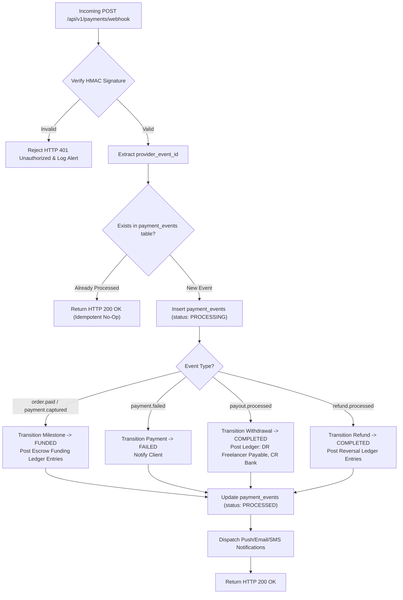

# Payment, Commission & Ledger Architecture: KaryaSetu (Freelancing For India)

## 1. Regulatory Context & Legal Principles in India

Operating a two-sided freelance marketplace in India involves strict compliance with financial regulations and tax laws:

### 1.1 Reserve Bank of India (RBI) Payment Aggregator & Nodal Escrow Regulations
- **Prohibition on Proprietary Pooling**: Under the RBI Master Directions on Payment Aggregators (PAs) and Payment Gateways (PGs), a marketplace technology platform that is not a licensed PA **cannot hold merchant or customer funds in its own ordinary current bank account**.
- **Regulatory Compliant Model**:
  1. **Option A: Regulated Escrow / Route Split Model (Recommended for launch)**: Leverage an RBI-authorized Payment Aggregator offering marketplace routing (such as **Razorpay Route** or **Cashfree Marketplace Split**). In this model, funds paid by the client enter the PA's RBI-monitored Nodal / Escrow account directly. The platform provides cryptographic transfer instructions to route the platform commission to the platform's bank account and the milestone balance to the verified freelancer's linked account upon milestone approval.
  2. **Option B: Trustee Escrow Mechanism**: Partner with an RBI-registered Escrow Trustee bank (e.g., ICICI Escrow, Axis Trustee, or EscrowPay) operating under a tripartite escrow agreement.

### 1.2 Indian Tax Deductions & Withholdings at Source
- **Section 194-O of the Income Tax Act (TDS on E-commerce Transactions)**:
  - The e-commerce marketplace operator is legally mandated to deduct **1% TDS** on the gross amount of sales or services facilitated through its platform at the time of credit or payment to the e-commerce participant (freelancer).
  - PAN is mandatory: If the freelancer has not provided a valid PAN, the withholding rate escalates to **5%** under Section 206AA.
- **Section 52 of the Central Goods and Services Tax (CGST) Act (GST TCS)**:
  - Every e-commerce operator must collect Tax Collected at Source (TCS) at **1%** (0.5% CGST + 0.5% SGST or 1% IGST) of the net value of taxable supplies made through it.
- **GST on Platform Services**:
  - The platform charges a **18% GST** on its platform commissions and client convenience fees (SAC Code: 998314 - Information technology services / Website hosting & marketplace services).

---

## 2. Payment Provider Abstraction Layer

To ensure vendor neutrality and absolute isolation of business logic from gateway SDKs, all payment operations are mediated by the `IPaymentProvider` interface.

```typescript
// src/core/payments/payment-provider.interface.ts

export interface CustomerDTO {
  userId: string;
  name: string;
  email: string;
  phone: string;
}

export interface CreateOrderParams {
  receipt: string;              // Internal unique reference (e.g. "KS-ORD-2026-001")
  amountInPaise: number;        // ₹50,000.00 = 5000000 paise
  currency: 'INR';
  customerId: string;
  notes: Record<string, string>;
}

export interface OrderResult {
  gatewayOrderId: string;
  amountInPaise: number;
  currency: string;
  status: 'created' | 'attempted' | 'paid';
}

export interface VerifyPaymentParams {
  gatewayOrderId: string;
  gatewayPaymentId: string;
  gatewaySignature: string;
}

export interface ConnectedAccountParams {
  freelancerId: string;
  businessName: string;
  contactName: string;
  email: string;
  phone: string;
  bankAccount: {
    accountNumber: string;
    ifscCode: string;
    holderName: string;
  };
}

export interface TransferParams {
  gatewayPaymentId: string;
  destinationAccountId: string;
  amountInPaise: number;
  notes: Record<string, string>;
}

export interface PayoutParams {
  withdrawalReference: string;
  destinationAccountId: string;
  amountInPaise: number;
  mode: 'IMPS' | 'NEFT' | 'RTGS' | 'UPI';
  purpose: 'payout';
}

export interface RefundParams {
  gatewayPaymentId: string;
  amountInPaise: number;
  reason: string;
  notes: Record<string, string>;
}

export interface WebhookEventResult {
  eventType: string;
  providerEventId: string;
  resourceId: string;
  status: 'SUCCESS' | 'FAILED' | 'IGNORED';
  rawPayload: any;
}

export interface IPaymentProvider {
  readonly providerName: string;

  /** Create or retrieve customer profile in gateway */
  createCustomer(customer: CustomerDTO): Promise<string>;

  /** Create gateway order for milestone funding checkout */
  createOrder(params: CreateOrderParams): Promise<OrderResult>;

  /** Cryptographically verify payment signature submitted by frontend */
  verifyPaymentSignature(params: VerifyPaymentParams): Promise<boolean>;

  /** Fetch authoritative payment status directly from gateway server */
  getPaymentStatus(gatewayPaymentId: string): Promise<{
    status: 'captured' | 'failed' | 'pending' | 'refunded';
    amountInPaise: number;
    paymentMethod: string;
    capturedAt: Date;
  }>;

  /** Create linked/connected account for freelancer on marketplace route */
  createConnectedAccount(params: ConnectedAccountParams): Promise<{ accountId: string }>;

  /** Route funds from escrow payment to freelancer connected account */
  transferToConnectedAccount(params: TransferParams): Promise<{ transferId: string }>;

  /** Initiate bank payout / withdrawal for freelancer */
  initiatePayout(params: PayoutParams): Promise<{ payoutId: string; utr?: string }>;

  /** Process full or partial refund to client */
  processRefund(params: RefundParams): Promise<{ refundId: string }>;

  /** Verify incoming webhook signature (HMAC-SHA256) */
  verifyWebhookSignature(rawBody: string, signature: string, secret: string): boolean;

  /** Parse and normalize gateway webhook event */
  parseWebhookEvent(rawBody: string): WebhookEventResult;
}
```

### 2.1 Concrete Providers
1. `MockDevelopmentPaymentProvider`: Deterministic local development adapter. Simulates order creation, signature generation, webhooks, settlement delays, and simulated failure scenarios (e.g., card declines, bank outages).
2. `RazorpayRoutePaymentProvider`: Production adapter utilizing Razorpay Orders API, Linked Accounts API, Transfers API, and RazorpayX Payouts.
3. `CashfreeMarketplacePaymentProvider`: Production adapter utilizing Cashfree Orders, Easy Split API, and Payouts.

---

## 3. Checkout UI & Transparent Fee Calculation Formula

### 3.1 Transparent Financial Breakdown
When a client funds a milestone of **₹50,000**, the checkout screen displays every component with complete clarity:

```
+-----------------------------------------------------------+
| MILESTONE FUNDING BREAKDOWN                               |
+-----------------------------------------------------------+
| Milestone Scope Amount:                    ₹ 50,000.00    |
| Platform Client Service Fee (3.0%):        ₹  1,500.00    |
| GST on Service Fee (18.0%):                ₹    270.00    |
| Payment Gateway Convenience Fee (2.0%):    ₹  1,000.00    |
|-----------------------------------------------------------|
| TOTAL PAYABLE BY CLIENT:                   ₹ 52,770.00    |
+-----------------------------------------------------------+
| ESTIMATED FREELANCER NET RECEIVABLE:                      |
| Gross Milestone Value:                     ₹ 50,000.00    |
| Less: Platform Commission (10.0%):       - ₹  5,000.00    |
| Less: GST on Platform Commission (18%):  - ₹    900.00    |
| Less: Section 194-O TDS Withholding (1%):- ₹    500.00    |
|-----------------------------------------------------------|
| Net Freelancer Payout:                     ₹ 43,600.00    |
+-----------------------------------------------------------+
```

### 3.2 Calculation Engine Invariants
1. **Never Calculate in Frontend**: The frontend requests `/api/v1/payments/quote?milestoneId=m-123`. The backend computes and signs the breakdown.
2. **Integer Arithmetic (Paise Representation)**: All monetary calculations in database and memory are executed in **paise** (`₹1.00 = 100 paise`) to eliminate IEEE-754 floating-point rounding inaccuracies.
3. **Configurable Commission Rules**: Admins configure commission rates dynamically per category, project value tiers, or user loyalty tiers.

---

## 4. Double-Entry Financial Ledger Architecture

KaryaSetu uses a strict double-entry general ledger to ensure that **every single rupee** flowing into or out of the system is accounted for.

### 4.1 Chart of Accounts

| Account Code | Account Name | Type | Description |
| :--- | :--- | :--- | :--- |
| **1010** | `GATEWAY_CLEARING` | Asset | Funds held by Payment Gateway awaiting settlement |
| **1020** | `NODAL_ESCROW_BANK` | Asset | Funds sitting in RBI-regulated Escrow Bank account |
| **1030** | `OPERATING_BANK` | Asset | Platform's corporate operational bank account |
| **2010** | `CLIENT_ESCROW_DEPOSIT` | Liability | Funds deposited by clients earmarked for milestones |
| **2020** | `FREELANCER_PAYABLE` | Liability | Cleared earnings owed to freelancers |
| **2030** | `GST_PAYABLE_CLIENT_FEE` | Liability | 18% GST collected on client service fees (to Govt) |
| **2040** | `GST_PAYABLE_COMMISSION`| Liability | 18% GST collected on freelancer commission (to Govt) |
| **2050** | `TDS_194O_PAYABLE` | Liability | 1% Section 194-O Income Tax withheld (to Govt) |
| **4010** | `REVENUE_CLIENT_FEES` | Revenue | Platform income from client service fees |
| **4020** | `REVENUE_COMMISSIONS` | Revenue | Platform income from freelancer commissions |
| **5010** | `EXPENSE_GATEWAY_FEES` | Expense | Fees charged by payment gateway provider |

### 4.2 Standard Journal Entries

#### Transaction 1: Client Funds Milestone Escrow (₹52,770 paid)
```text
Debit:  1010 GATEWAY_CLEARING            ₹ 52,770.00 (Asset Increases)
Credit: 2010 CLIENT_ESCROW_DEPOSIT       ₹ 50,000.00 (Liability Increases)
Credit: 4010 REVENUE_CLIENT_FEES         ₹  1,500.00 (Revenue Increases)
Credit: 2030 GST_PAYABLE_CLIENT_FEE      ₹    270.00 (Tax Liability Increases)
Credit: 5010 EXPENSE_GATEWAY_FEES (Contra) ₹ 1,000.00 (Payment Processing)
TOTAL DEBITS: ₹ 52,770.00 | TOTAL CREDITS: ₹ 52,770.00  [BALANCED]
```

#### Transaction 2: Gateway Settles Funds into Nodal Escrow Bank (Gross ₹52,770 - PG Fee ₹1,000 = ₹51,770)
```text
Debit:  1020 NODAL_ESCROW_BANK           ₹ 51,770.00 (Asset Increases)
Debit:  5010 EXPENSE_GATEWAY_FEES        ₹  1,000.00 (Gateway Fee Expensed)
Credit: 1010 GATEWAY_CLEARING            ₹ 52,770.00 (Clearing Cleared)
TOTAL DEBITS: ₹ 52,770.00 | TOTAL CREDITS: ₹ 52,770.00  [BALANCED]
```

#### Transaction 3: Client Approves Milestone Delivery (Milestone Value: ₹50,000)
```text
Debit:  2010 CLIENT_ESCROW_DEPOSIT       ₹ 50,000.00 (Escrow Liability Discharged)
Credit: 2020 FREELANCER_PAYABLE          ₹ 43,600.00 (Payable to Freelancer Created)
Credit: 4020 REVENUE_COMMISSIONS         ₹  5,000.00 (Platform Commission Earned)
Credit: 2040 GST_PAYABLE_COMMISSION      ₹    900.00 (18% GST on Commission)
Credit: 2050 TDS_194O_PAYABLE            ₹    500.00 (1% TDS Withheld u/s 194-O)
TOTAL DEBITS: ₹ 50,000.00 | TOTAL CREDITS: ₹ 50,000.00  [BALANCED]
```

#### Transaction 4: Freelancer Withdraws Funds to Bank Account (₹43,600 Payout)
```text
Debit:  2020 FREELANCER_PAYABLE          ₹ 43,600.00 (Liability Cleared)
Credit: 1020 NODAL_ESCROW_BANK           ₹ 43,600.00 (Escrow Bank Disburses Funds)
TOTAL DEBITS: ₹ 43,600.00 | TOTAL CREDITS: ₹ 43,600.00  [BALANCED]
```

#### Transaction 5: Platform Sweeps Earned Commission from Escrow to Operating Bank
```text
Debit:  1030 OPERATING_BANK              ₹  7,670.00 (Platform Bank Receives Net Revenue)
Credit: 1020 NODAL_ESCROW_BANK           ₹  7,670.00 (Escrow Bank Releases Platform Earnings)
TOTAL DEBITS: ₹ 7,670.00 | TOTAL CREDITS: ₹ 7,670.00  [BALANCED]
```

---

## 5. Webhook Ingestion & Idempotency Pipeline



---

## 6. Payment Reconciliation Engine

The platform incorporates an automated nightly reconciliation worker:
1. **Extraction**:
   - Pulls all settled transactions from the Payment Gateway Settlement API for the previous 24 hours.
   - Pulls all recorded `payments` and `settlements` from the platform database for the matching window.
2. **Comparison Matrix**:
   - Compares Gateway Order ID, Payment ID, Gross Amount, Gateway Fees, and Net Payout amount against platform records.
3. **Discrepancy Categorization**:
   - **Matched**: Exact match on IDs and amounts.
   - **Orphan Gateway Transaction**: Payment captured in gateway without corresponding internal order record.
   - **Amount Mismatch**: Discrepancy between client charged amount and gateway gross recorded amount.
   - **Settlement Lag**: Internal record marked cleared, but gateway settlement failed or delayed.
4. **Actionable Alerts**: Any discrepancy is flagged in the Finance Admin Dashboard for immediate resolution without modifying ledger history.
